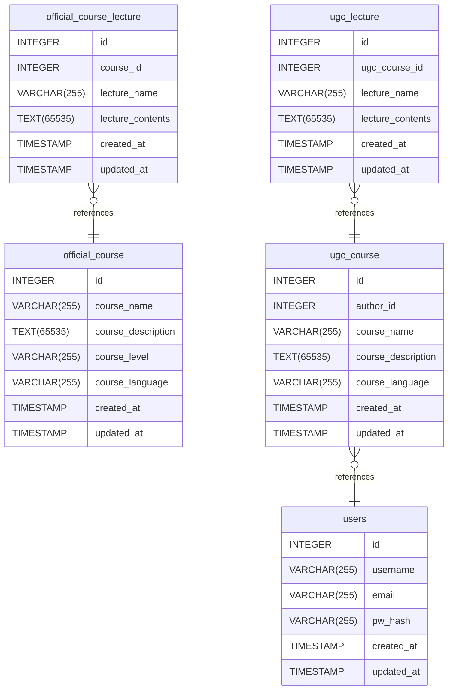

# Untitled Diagram documentation
## Summary

- [Introduction](#introduction)
- [Database Type](#database-type)
- [Table Structure](#table-structure)
	- [users](#users)
	- [official_course](#official_course)
	- [official_course_lecture](#official_course_lecture)
	- [ugc_course](#ugc_course)
	- [ugc_lecture](#ugc_lecture)
- [Relationships](#relationships)
- [Database Diagram](#database-diagram)

## Introduction

## Database type

- **Database system:** MySQL
## Table structure

### users

| Name           | Type         | Settings                               | References | Note |
| -------------- | ------------ | -------------------------------------- | ---------- | ---- |
| **id**         | INTEGER      | 🔑 PK, not null, unique, autoincrement |            |      |
| **username**   | VARCHAR(255) | not null, unique                       |            |      |
| **email**      | VARCHAR(255) | not null, unique                       |            |      |
| **pw_hash**    | VARCHAR(255) | not null                               |            |      |
| **created_at** | TIMESTAMP    | null                                   |            |      |
| **updated_at** | TIMESTAMP    | null                                   |            |      | 

### official_course

| Name                   | Type         | Settings                               | References | Note |
| ---------------------- | ------------ | -------------------------------------- | ---------- | ---- |
| **id**                 | INTEGER      | 🔑 PK, not null, unique, autoincrement |            |      |
| **course_name**        | VARCHAR(255) | not null                               |            |      |
| **course_description** | TEXT(65535)  | not null                               |            |      |
| **course_level**       | VARCHAR(255) | not null                               |            |      |
| **course_language**    | VARCHAR(255) | not null                               |            |      |
| **created_at**         | TIMESTAMP    | not null                               |            |      |
| **updated_at**         | TIMESTAMP    | not null                               |            |      | 

### official_course_lecture

| Name                 | Type         | Settings                       | References                                           | Note |
| -------------------- | ------------ | ------------------------------ | ---------------------------------------------------- | ---- |
| **id**               | INTEGER      | 🔑 PK, not null, autoincrement |                                                      |      |
| **course_id**        | INTEGER      | not null                       | fk_official_course_lecture_course_id_official_course |      |
| **lecture_name**     | VARCHAR(255) | not null                       |                                                      |      |
| **lecture_contents** | TEXT(65535)  | not null                       |                                                      |      |
| **created_at**       | TIMESTAMP    | not null                       |                                                      |      |
| **updated_at**       | TIMESTAMP    | not null                       |                                                      |      | 

### ugc_course

| Name                   | Type         | Settings                       | References                    | Note |
| ---------------------- | ------------ | ------------------------------ | ----------------------------- | ---- |
| **id**                 | INTEGER      | 🔑 PK, not null, autoincrement |                               |      |
| **author_id**          | INTEGER      | not null                       | fk_ugc_course_author_id_users |      |
| **course_name**        | VARCHAR(255) | not null                       |                               |      |
| **course_description** | TEXT(65535)  | not null                       |                               |      |
| **course_language**    | VARCHAR(255) | not null                       |                               |      |
| **created_at**         | TIMESTAMP    | not null                       |                               |      |
| **updated_at**         | TIMESTAMP    | not null                       |                               |      | 

### ugc_lecture

| Name                 | Type         | Settings                       | References                              | Note |
| -------------------- | ------------ | ------------------------------ | --------------------------------------- | ---- |
| **id**               | INTEGER      | 🔑 PK, not null, autoincrement |                                         |      |
| **ugc_course_id**    | INTEGER      | not null                       | fk_ugc_lecture_ugc_course_id_ugc_course |      |
| **lecture_name**     | VARCHAR(255) | not null                       |                                         |      |
| **lecture_contents** | TEXT(65535)  | not null                       |                                         |      |
| **created_at**       | TIMESTAMP    | not null                       |                                         |      |
| **updated_at**       | TIMESTAMP    | not null                       |                                         |      | 

## Relationships

- **official_course_lecture to official_course**: many_to_one
- **ugc_lecture to ugc_course**: many_to_one
- **ugc_course to users**: many_to_one

## Database Diagram

